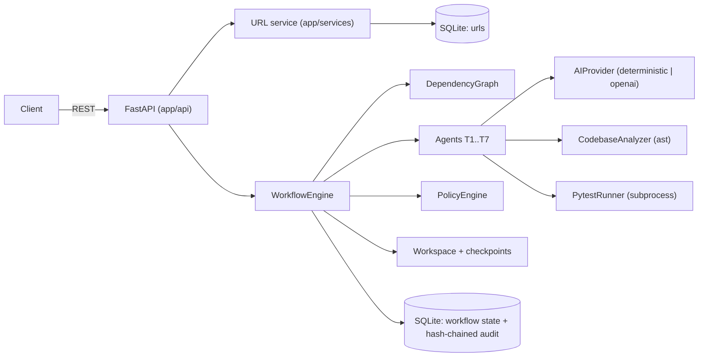

# Architecture

## Components

The product (`app/`) and the orchestrator (`orchestrator/`) are separate packages. The orchestrator
only *reads* the product through the `ast` analyzer and writes generated code to an isolated
per-workflow workspace, never to the live repository.

## Control flow

1. `POST /api/workflows` creates state, persists it and runs the loop until it blocks.
2. The loop asks the graph for *ready* nodes (pending, all dependencies `completed`).
3. Ready **tasks** run as one batch in a thread pool. Workers touch no shared state; they return a
   `NodeResult`, and the main thread records counters, outputs, incidents and audit events.
4. A ready **gate** opens and the workflow waits (`awaiting_*_approval`). Approval, clarification or
   re-planning re-enters the loop.
5. When every node is complete the workflow becomes `release_ready`.

## Application Data Model

The URL shortener uses two main entities: ShortURL and ClickEvent.

mermaid
erDiagram
    SHORT_URL {
        int id PK
        string code UK
        string target_url
        datetime created_at
        datetime expires_at
        boolean active
        int clicks
    }

    CLICK_EVENT {
        int id PK
        int short_url_id FK
        datetime clicked_at
        string referrer
        string user_agent
    }

    SHORT_URL ||--o{ CLICK_EVENT : records

ShortURL stores the short-code mapping, target URL, status, optional expiration and aggregate click count.

ClickEvent stores individual redirect events used for analytics. One ShortURL can have multiple ClickEvent records.

SQLite is used for the assessment prototype to keep local setup simple. SQLAlchemy keeps persistence separated from the API and service layers, allowing PostgreSQL or another relational database to be introduced for production without changing the external API contract.

## Orchestration Persistence

Workflow information is stored separately from the URL-shortener application data.

mermaid
erDiagram
    WORKFLOW_RUN ||--o{ AUDIT_EVENT : contains

    WORKFLOW_RUN {
        string id PK
        string status
        int version
        datetime created_at
        datetime updated_at
        text data
    }

    AUDIT_EVENT {
        int id PK
        string workflow_id FK
        int seq
        datetime timestamp
        string node_id
        string event
        text detail
        string prev_hash
        string hash
    }

WorkflowRun maintains the current workflow state, including requirement version, task and gate status, outputs, decisions, incidents and reliability information.

AuditEvent maintains the history of workflow activities. Audit events are sequence-controlled and hash-chained so the application can verify whether previously stored workflow history has been modified.

## Workflow states

`running`, `awaiting_clarification`, `awaiting_implementation_approval`,
`awaiting_release_approval`, `release_ready`, `rejected_implementation`, `rejected_release`,
`safe_stopped_policy`, `safe_stopped_failure`, `safe_stopped_rolled_back`,
`safe_stopped_validation`. Everything except `running` and `awaiting_*` is terminal for metrics, and
a human can still recover from any non-released terminal state with a re-plan.

## Key decisions

| Decision | Rationale |
|---|---|
| Modular monolith | Right size for the scope; boundaries (API / service / persistence / orchestration) allow later extraction |
| Workers return results, main thread mutates state | Removes data races without fine-grained locking |
| Per-workflow `RLock` | Serialises transitions for one workflow while others proceed |
| State persisted after every transition | Restart-safe; the audit log is the source of truth for lineage |
| Hash-chained audit events | Tamper evidence without external infrastructure |
| Generated code in a sandboxed workspace | Agents have bounded authority; a human decides what to merge |
| Pre-implementation checkpoint taken at `G1` approval | Rollback target is exactly what the human approved |
